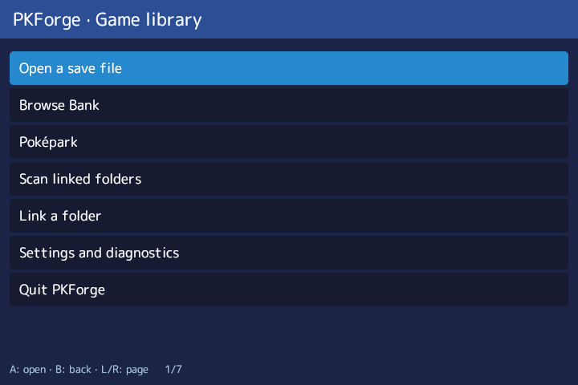

# PKForge-ARM-LINUX for ROCKNIX and KNULLI

A native ARM64 Linux port of [PKForge](https://github.com/sofianeelhor/PKForge) by **sofianeelhor**, maintained here by **DankMiimer**. Based on upstream **v3.1.1**, with the rebuilt Poképark, a native save library, Pokémon editors and Bank tools.

**[Download the Linux preview](https://github.com/DankMiimer/PKForge-ARM-LINUX/releases)** · [Installation and controls](LINUX.md) · [Feature coverage](FEATURE_COVERAGE.md) · [Validation](VALIDATION.md) · [Original project](https://github.com/sofianeelhor/PKForge)

This is a **development preview**, Linux revision **0.2.2-dev**. Broad editor functionality is implemented, but full v3.1.1 parity and every game/format path have not completed acceptance. The feature matrix distinguishes implementation from verified behavior.



## Reference handhelds

| Handheld | Firmware tested | Layout |
| --- | --- | --- |
| Anbernic RGDS | ROCKNIX 20261001 | Main view above; inspector, menus and park journal below; touch and gamepad |
| Anbernic RG34XXSP | KNULLI Scarab | Single-screen tabs and overlays; gamepad operated |

Other ARM64 ROCKNIX/KNULLI handhelds are experimental. The package bundles .NET 10; the firmware supplies SDL2, SDL2_mixer and the required Linux graphics/system libraries.

## Install and update

1. Download `PKForge-v3.1.1-linux-0.2.2-dev-arm64.zip` from this fork's Releases page.
2. Extract it into `/storage/roms/ports/` on ROCKNIX or `/userdata/roms/ports/` on KNULLI. Keep both launchers beside the `pkforge` folder.
3. Refresh the Ports list. **PKForge** opens Home; **PKForge Pokepark** opens the park directly.

When updating, close PKForge and preserve the complete **`pkforge/userdata`** folder. It contains the Bank, park residents, settings, restore points, sprite cache and photos. Release ZIPs do not contain personal userdata. Save in game and close the emulator before editing; keep your own copy of important saves.

PKForge respects the firmware's existing power/lid settings. It saves and pauses its own activity on lid events without changing OS policy or preventing shutdown.

## What is included

- Upstream Poképark simulation, map, weather, social interactions, daycare and photo album, with up to 24 residents and cached animated sprites.
- Native library discovery, linked emulator folders, edition selection and persistent catalogue.
- Party/box browsing, Pokémon editing, legality tools, Bank organization, transfers and recovery journals.
- Creation, offline events, collection tracking, Showdown/QR and capability-filtered save/game-specific tools.
- Gamepad navigation, touch on RGDS, on-screen text entry and local import/export flows.

Revision 0.2.2 corrects Swellow's spinning flight and Donphan's upright Rollout animation; both visual fixes were confirmed by the device owner. Android-compatible shared workflows are retained, but this fork's release downloads are Linux packages. Official Android releases remain [upstream](https://github.com/sofianeelhor/PKForge/releases).

## Verification and current limits

The current desktop suite has **1,898 passing tests**; the shared workflow/animation harness passes **71/71 cases on each reference handheld**. Earlier 31-minute hardware runs met the warm park target of at least 29.5 FPS in each measured park-only minute. Long-session memory stability, broader advanced-editor/format coverage and the remaining acceptance items are still open. These are historical hardware measurements, not guarantees for every device or scene.

See [VALIDATION.md](VALIDATION.md) and [FEATURE_COVERAGE.md](FEATURE_COVERAGE.md) before relying on a particular editor or format. RGDS lid resume was owner-confirmed. The reference RG34XXSP uses shutdown on lid close, so its physical suspend/resume path was not exercised under that setting.

## Build from source

The pinned .NET **10.0.103 SDK** is required. The ARM64 runtime is pinned to **10.0.3**. From a clean recursive clone:

```powershell
git clone --recurse-submodules https://github.com/DankMiimer/PKForge-ARM-LINUX.git
cd PKForge-ARM-LINUX
dotnet test PKForge.Linux.slnx -c Release
pwsh -File tools/linux/build.ps1
pwsh -File tools/linux/verify-package.ps1
```

Release assets are written to `dist/`: binary ZIP, complete source ZIP, `SHA256SUMS.txt` and `BUILDINFO.json`. The complete source ZIP includes both pinned submodule trees; extract it and run the same test/build commands, without cloning or initializing submodules. Its manifest verifies the source files before packaging. Builds restore NuGet dependencies from the network.

[Release procedure](RELEASING.md) describes CI, provenance and device checks. The upstream Android build instructions and original credits are preserved in [README.upstream.md](README.upstream.md).

## Credits and license

PKForge and its original design, simulation and application are by **sofianeelhor** and upstream contributors. This fork reuses the pinned PKHeX engine and Auto Legality Mod, Skia rendering and upstream assets. Credits include spritedmistery, AlchemyBats, PMDCollab/SpriteCollab artists, PKSM, Pokémon Showdown/Smogon, PokeAPI and the other projects listed in [Attribution](packaging/linux/ATTRIBUTION.md) and the original README. Runtime and asset notices are included in the package.

The code retains the upstream GPLv3-or-later licensing; see [LICENSE](LICENSE). Third-party assets and libraries retain their respective licenses and attribution. Pokémon names and artwork belong to their respective owners. This project is not affiliated with Nintendo, Creatures Inc., GAME FREAK or The Pokémon Company.
