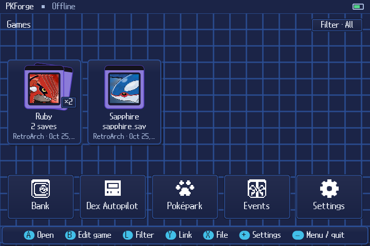
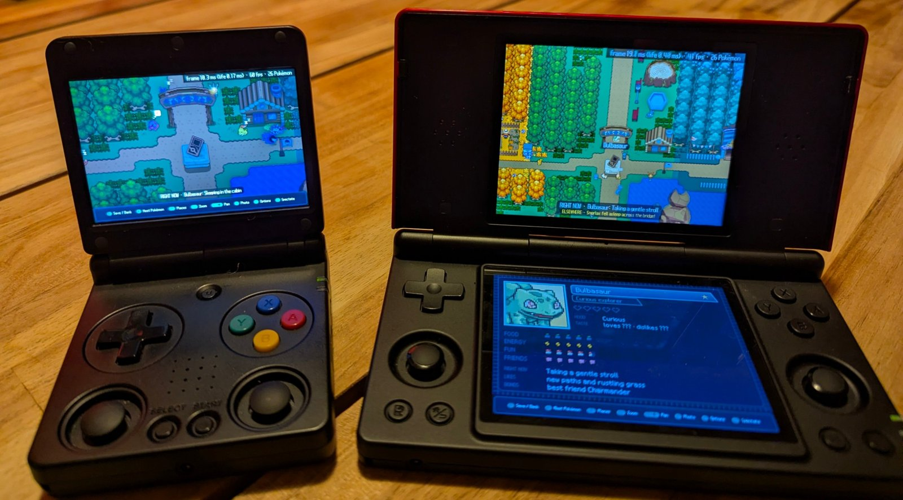
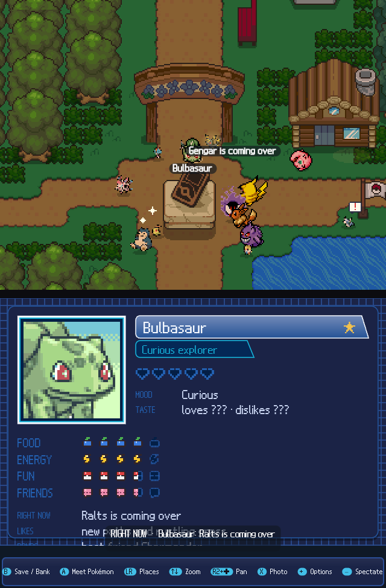
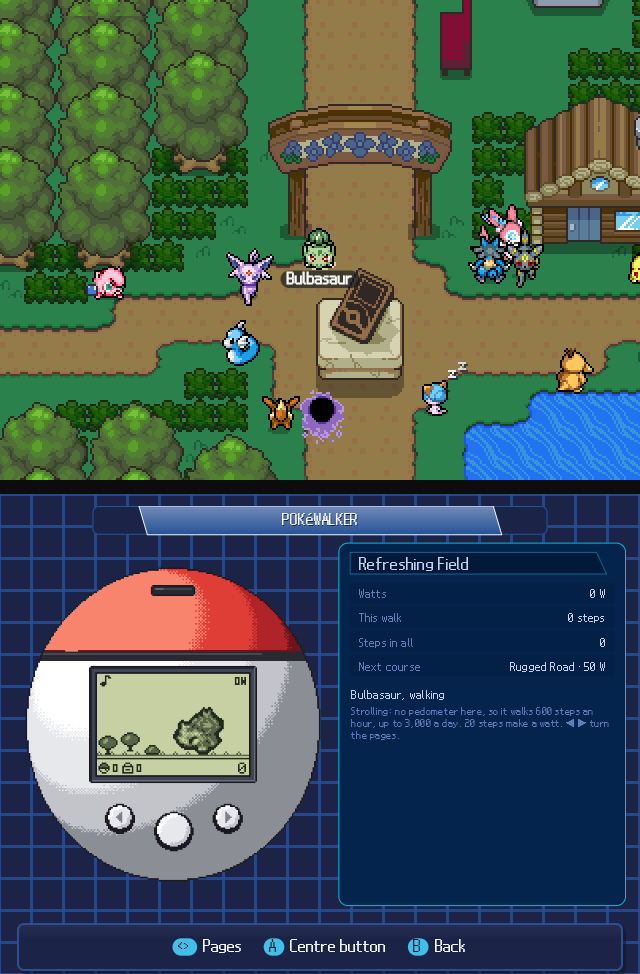
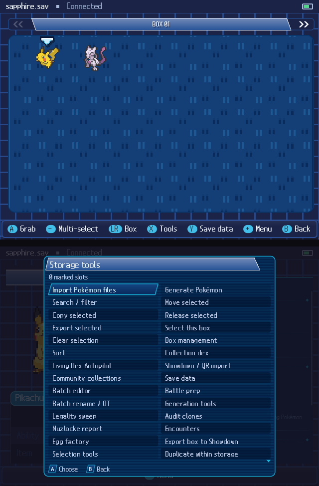
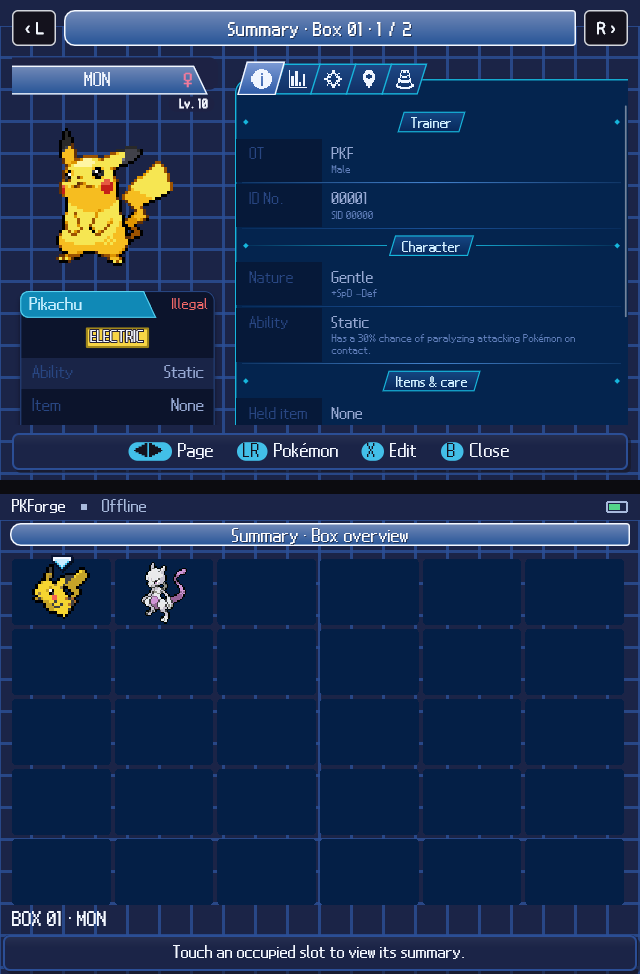
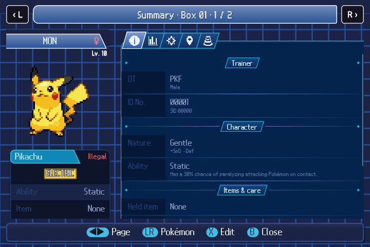
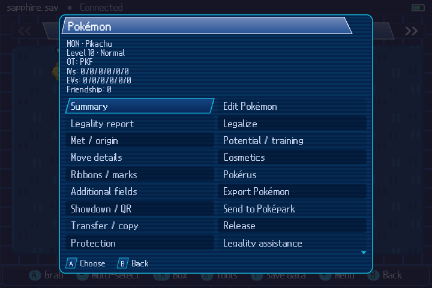
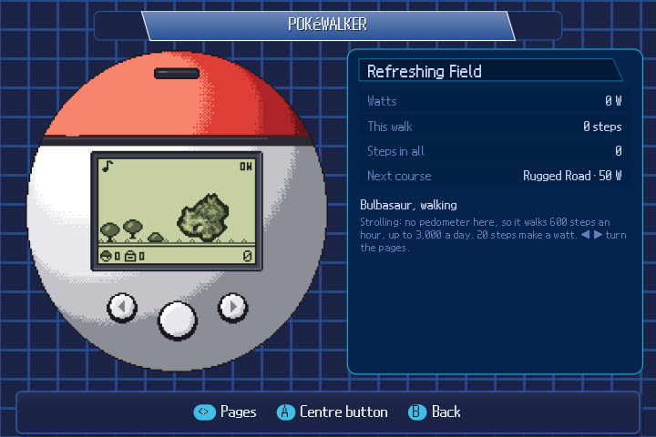

# PKForge-ARM-LINUX for ROCKNIX and KNULLI

A native ARM64 Linux port of [PKForge](https://github.com/sofianeelhor/PKForge) by **sofianeelhor**, maintained here by **DankMiimer**. This branch integrates upstream **v3.2.0**, including Item Bank, the handheld Pokéwalker, save snapshots and museum, and the updated engines and painted menus.

**[Download the Linux preview](https://github.com/DankMiimer/PKForge-ARM-LINUX/releases)** · [Installation and controls](LINUX.md) · [Test it on your handheld](TESTING.md) · [Feature coverage](FEATURE_COVERAGE.md) · [Validation](VALIDATION.md) · [Original project](https://github.com/sofianeelhor/PKForge)

The current preview is Linux revision **0.2.7-dev**, based on upstream **v3.2.0**. See [3.2.0 support](UPSTREAM_3_2_0_SUPPORT.md) for integration and acceptance limits. It follows **0.2.6-dev**; **0.2.4-dev** was the first v3.2.0 preview, and the earlier **0.2.3-dev** packages use upstream **v3.1.1**. Full visual parity and every game/format path remain acceptance work; shared source and passing tests do not establish hardware acceptance.



## Reference handhelds



*The two reference handhelds running the Poképark, November 2026: the RG34XXSP on the left, the RGDS on the right with the resident's journal on its lower screen. Photographed during a test run of a development build, with the frame-time readout shown at the top.*

| Handheld | Firmware tested | Layout |
| --- | --- | --- |
| Anbernic RGDS | ROCKNIX 20261001 | Main view above; inspector, menus and park journal below; touch and gamepad |
| Anbernic RG34XXSP | KNULLI Scarab | Single-screen tabs and overlays; gamepad operated |

Other ARM64 ROCKNIX/KNULLI handhelds are experimental. The packages bundle .NET 10 and app-local ICU; ARM64 glibc 2.29+ and firmware SDL2 are required. Missing audio is nonfatal; GLES falls back to raster where the SDL backend supports it. KNULLI's Mali backend still needs working firmware EGL. Experimental packages also target muOS, dArkOS and NextUI; see LINUX.md for installation and validation status.

## Screenshots

Captured on the two reference handhelds in November 2026, from the 0.2.7-dev
release archive, with demonstration data.

**Anbernic RGDS** — both screens, top above bottom:

| Poképark and its journal | Pokéwalker | Boxes and storage tools | Summary and box overview |
| --- | --- | --- | --- |
|  |  |  |  |

**Anbernic RG34XXSP** — one screen:

| Pokémon summary | Pokémon menu | Pokéwalker |
| --- | --- | --- |
|  |  |  |

## Install and update

1. Download `PKForge-v3.2.0-linux-0.2.7-dev-arm64.zip` from this fork's Releases page.
2. Extract it into `/storage/roms/ports/` on ROCKNIX or `/userdata/roms/ports/` on KNULLI. Keep both launchers beside the `pkforge` folder.
3. Refresh the Ports list. **PKForge** opens Home; **PKForge Pokepark** opens the park directly.

When updating, close PKForge and preserve the complete **`pkforge/userdata`** folder. It contains the Bank, park residents, settings, restore points, sprite cache and photos. Release ZIPs do not contain personal userdata. Save in game and close the emulator before editing; keep your own copy of important saves.

PKForge respects the firmware's existing power/lid settings. It saves and pauses its own activity on lid events without changing OS policy or preventing shutdown.

## What is included

- Upstream Poképark simulation, map, weather, social interactions, daycare and photo album, with up to 24 residents and cached animated sprites.
- Native library discovery, linked emulator folders, edition selection and persistent catalogue.
- Party/box browsing, Pokémon editing, legality tools, Bank organization, transfers and recovery journals.
- Creation, offline events, collection tracking, Showdown/QR and capability-filtered save/game-specific tools.
- Gamepad navigation, touch on RGDS, on-screen text entry and local import/export flows.

Revision 0.2.2 corrects Swellow's spinning flight and Donphan's upright Rollout animation; both visual fixes were confirmed by the device owner. Android-compatible shared workflows are retained, but this fork's release downloads are Linux packages. Official Android releases remain [upstream](https://github.com/sofianeelhor/PKForge/releases).

## Verification and current limits

The desktop suites pass **3,394 tests** (1,437 Domain, 1,741 Engine, 77 Park, 139 Linux UI) and 17 launcher scenarios. In November 2026, frame timing on both reference handhelds was measured in automatic rounds with scripted input. With the 0.2.6 drawing change, every warm park-only minute of a 90-minute soak ran at 29.5 FPS or more on both, and the Pokéwalker under the park on the RGDS at 60 FPS for 41 minutes; on the RG34XXSP it runs at about 56 FPS. Memory over 90 minutes settled at about 550–570 MiB. Long-session memory stability across Home and the editors, broader advanced-editor/format coverage and the remaining acceptance items are still open. These are measurements of particular builds and scenes, not guarantees for every device.

See [VALIDATION.md](VALIDATION.md) and [FEATURE_COVERAGE.md](FEATURE_COVERAGE.md) before relying on a particular editor or format. RGDS lid resume was owner-confirmed. The reference RG34XXSP uses shutdown on lid close, so its physical suspend/resume path was not exercised under that setting.

Android visual and animation matching is in progress: [plans, implemented work and remaining acceptance](ANDROID_PARITY_PROGRESS.md).

[Handheld compatibility](HANDHELD_COMPATIBILITY.md) records the portable runtime
requirements and distinguishes hardware evidence from simulated launcher checks.

## Build from source

The pinned .NET **10.0.103 SDK** is required. The ARM64 runtime is pinned to **10.0.3**. From a clean recursive clone:

```powershell
git clone --recurse-submodules https://github.com/DankMiimer/PKForge-ARM-LINUX.git
cd PKForge-ARM-LINUX
dotnet test PKForge.Linux.slnx -c Release
pwsh -File tools/linux/build.ps1
pwsh -File tools/linux/verify-package.ps1
```

Release assets are written to `dist/`: binary ZIP, complete source ZIP, `SHA256SUMS.txt` and `BUILDINFO.json`. The complete source ZIP includes both pinned submodule trees; extract it and run the same test/build commands, without cloning or initializing submodules. Its manifest verifies the source files before packaging. Builds restore NuGet dependencies from the network.

[Release procedure](RELEASING.md) describes CI, provenance and device checks. The upstream Android build instructions and original credits are preserved in [README.upstream.md](README.upstream.md).

## Credits and license

PKForge and its original design, simulation and application are by **sofianeelhor** and upstream contributors. This fork reuses the pinned PKHeX engine and Auto Legality Mod, Skia rendering and upstream assets. Credits include spritedmistery, AlchemyBats, PMDCollab/SpriteCollab artists, PKSM, Pokémon Showdown/Smogon, PokeAPI and the other projects listed in [Attribution](packaging/linux/ATTRIBUTION.md) and the original README. Runtime and asset notices are included in the package.

The code retains the upstream GPLv3-or-later licensing; see [LICENSE](LICENSE). Third-party assets and libraries retain their respective licenses and attribution. Pokémon names and artwork belong to their respective owners. This project is not affiliated with Nintendo, Creatures Inc., GAME FREAK or The Pokémon Company.
