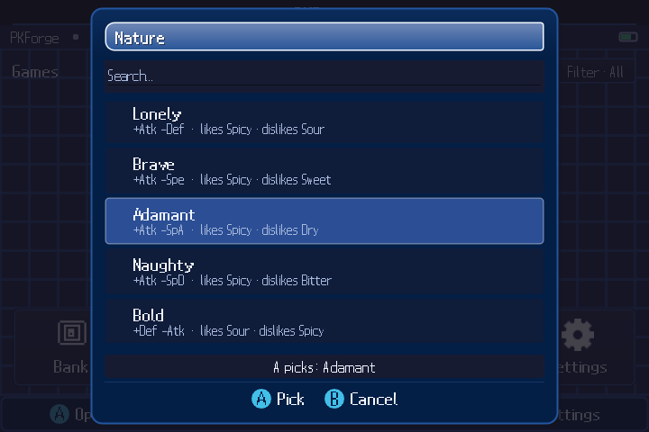
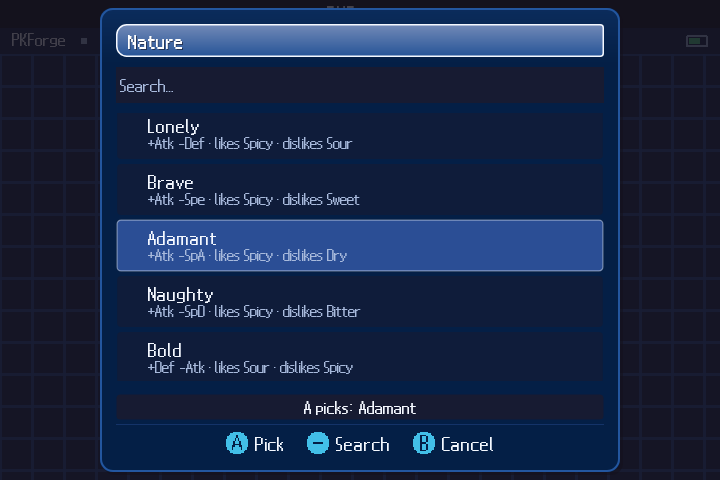

# Settled picker diagnostic

These disposable-fixture captures show Android v3.1.1 and the Linux raster host
at 720×480 with Adamant selected after navigation. [The evidence manifest](evidence.json)
records APK/source/image hashes, measured bounds and the comparison region.

The five compared row-label rectangles match exactly. The picker body
has 92.35% exact pixels; 3,589 changed pixels have no reference color within one
pixel at color tolerance 8. These numbers do not grant acceptance. Remaining
raster differences, initial opening/centering, the 640px reference and the full
state/timeline matrix remain open.

The Linux search hint is an intentional platform-input adaptation. This body
comparison does not validate either footer or the underlying Home screen.

Android diagnostic reference:

Linux preview:

To reproduce Linux component frames, publish `tools/UiPreview` for `linux-x64`
and run it on Linux with a fresh output directory. `picker-navigated-720x480.png`
is the settled capture; `picker-720x480.png` records the initial state separately.
The Android setup and diagnostic-harness procedure are in
[the parity tooling guide](../../../tools/parity/README.md).
